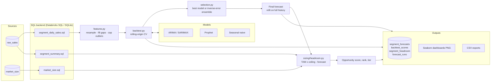

# TrendScope

**Sales forecasting and opportunity sizing.**

TrendScope is a batch analytics pipeline that forecasts sales for every business segment
(region x product line x channel) and works out how much addressable revenue is still on
the table in each one. It:

- **Ingests** transactional sales and market-size data with plain SQL, against a
  **Databricks SQL warehouse** in production or a local **SQLite** file for development.
- **Forecasts** each segment with **Prophet** and **ARIMA** (statsmodels SARIMAX with an
  AIC order search and Fourier yearly seasonality), plus a seasonal-naive baseline.
- **Backtests** every model with rolling-origin cross-validation (MAPE, sMAPE, RMSE, MASE,
  bias and interval coverage), then picks the best model per segment or blends the
  strongest ones with inverse-error weights.
- **Sizes headroom**: `capturable = TAM x penetration ceiling`, and
  `headroom = max(0, capturable - next-12-month forecast)`, with a low/high range taken from
  the forecast interval. Headroom, forecast growth and model confidence are combined into a
  0-100 **opportunity score** that ranks segments and assigns each one a tier
  (Invest / Grow / Monitor / Defend).
- **Visualizes** results as **Seaborn** dashboards and writes forecasts, backtest scores
  and headroom back to SQL tables and CSV.

## Architecture



### Project layout

```
trendscope/
  config.py              YAML config + env overrides
  ingest.py              schema setup, loading, SQL pulls
  features.py            resampling, outlier capping, splits
  db/                    SqlBackend interface, SQLite + Databricks implementations
  data/synthetic.py      synthetic sales + TAM generator for local runs
  models/                ARIMA, Prophet, seasonal-naive behind one Forecaster interface
  evaluation/            metrics + rolling-origin backtesting
  selection.py           per-segment model selection / ensembling
  sizing/headroom.py     headroom and opportunity scoring
  viz/                   Seaborn theme, chart builders, dashboard composer
  persist.py             write results to SQL + CSV
  pipeline.py            end-to-end orchestration
  cli.py                 `trendscope seed | load | run`
sql/                     schema and queries (shared by both backends)
config/default.yaml      default pipeline settings
databricks/              notebook job + Jobs API definition
tests/                   pytest suite
```

## How to run

Requires Python 3.10+.

```bash
python -m venv .venv && source .venv/bin/activate
pip install -e ".[prophet,dev]"        # drop "prophet" to run ARIMA + baseline only
cp .env.example .env                   # defaults to the local SQLite backend
```

### Locally with synthetic data

```bash
# Generate 4 years of synthetic sales for 24 segments, then run the full pipeline
trendscope run --seed

# Other options
trendscope run --frequency M --horizon 12          # monthly forecasts
trendscope run --models arima,seasonal_naive       # skip Prophet
trendscope run --segment "NA | Software" --workers 4
trendscope run --no-plots --no-persist             # print the ranking only
```

The CLI prints the top-ranked segments. Outputs land in `output/<run_id>/`:

- `dashboards/overview.png` — revenue by region, model mix, backtest error spread, opportunity map
- `dashboards/headroom.png` — top segments by headroom (with ranges) and the opportunity map
- `dashboards/accuracy.png` — sMAPE heatmap by segment and model
- `dashboards/top_segments_forecast.png` and `dashboards/segments/*.png` — forecasts with intervals
- `exports/*.csv` — forecasts, backtest scores and headroom

The same results are written to the `segment_forecasts`, `backtest_scores`,
`segment_headroom` and `forecast_runs` tables (plus a `latest_headroom` view).

### With your own data

```bash
trendscope load --sales sales.csv --market market_size.csv
trendscope run
```

`sales.csv` needs `order_id, order_date, region, product_line, channel, units, revenue`;
`market_size.csv` needs `region, product_line, channel, year, tam`.

### On Databricks

1. Store connection details in a secret scope (`server_hostname`, `http_path`, `token`), or
   set `TRENDSCOPE_BACKEND=databricks` and the `DATABRICKS_*` variables from `.env.example`
   when running from your own machine.
2. Install the package on the cluster with `pip install -e ".[prophet,databricks]"`.
3. Run `databricks/trendscope_job.py` as a notebook, or create the scheduled job from
   `databricks/job.json` (weekly, Monday 06:00 UTC). Tables are created in
   `<catalog>.<schema>` and dashboards are saved to the configured volume path.

You need a Databricks workspace with a SQL warehouse and a personal access token (or
service principal token) for this mode. Nothing else needs credentials.

### Configuration

`config/default.yaml` holds the forecast frequency/horizon, model list, selection metric,
backtest folds and the sizing parameters (`penetration_ceiling` and the score weights).
Pass a different file with `--config path.yaml`. Environment variables override the
backend, paths and Databricks connection settings.

## How to test

```bash
pip install -e ".[dev]"
pytest                       # whole suite
pytest tests/test_headroom.py -v
pytest --cov=trendscope
```

The tests use an in-memory SQLite database and small synthetic datasets, so they need no
network access or credentials. The Prophet test is skipped automatically if Prophet is not
installed. `tests/test_pipeline.py` runs the whole pipeline (seed, forecast, backtest,
sizing, persistence and dashboards) end to end.
